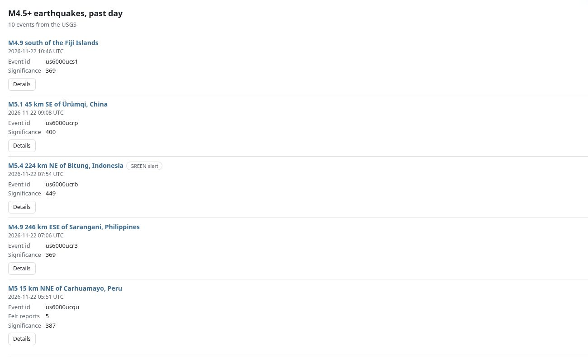

# Earthquake Watch

Turn “Was that an earthquake?” into a checkable USGS catalog result. Search near a place or across a worldwide feed, then open the event record for time, depth, magnitude, and the source link.

[Connect with Claude, ChatGPT, Muse Code, or Grok](PROVIDERS.md)

## Try it

- I felt shaking around 9 pm local time in Berkeley yesterday. Which catalog events fit that window?
- Show the most recent magnitude 4.5 or larger earthquakes worldwide and open the strongest of the returned events.

## Install in Claude

In Claude Code, run the following commands.

```text
/plugin marketplace add OpZero-sh/plugins
/plugin install earthquake-watch@opzero
```

In Claude chat or Cowork, open the installed plugin’s **Connectors** tab and connect the listed service. The hosted services use public data and require no sign-in. Then ask a question or use the `quake-brief` skill. In Cowork or Claude Code, the `event-match` agent can handle a deeper comparison.

## Sources and coverage

The USGS catalog and feeds can be revised. A radius search filters by epicenter. Felt reports, instrument magnitude, alert level, and the tsunami flag are separate fields. For active tsunami alerts in the US, consult the U.S. Tsunami Warning System.

[USGS Earthquake Hazards Program](https://earthquake.usgs.gov/) · [U.S. Tsunami Warning System](https://www.tsunami.gov/)

- [earthquake-watch](https://earthquake-watch.mcp.opzero.sh/) · [Privacy](https://earthquake-watch.mcp.opzero.sh/?page=privacy) · [Support](https://earthquake-watch.mcp.opzero.sh/?page=support)

## In use

Examples from the connected services in Claude.


